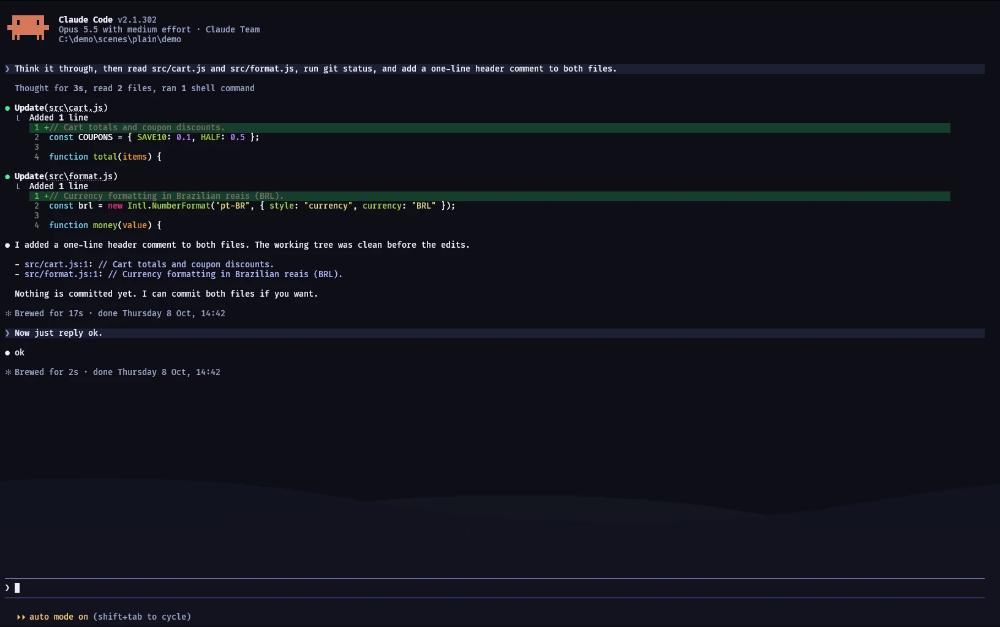
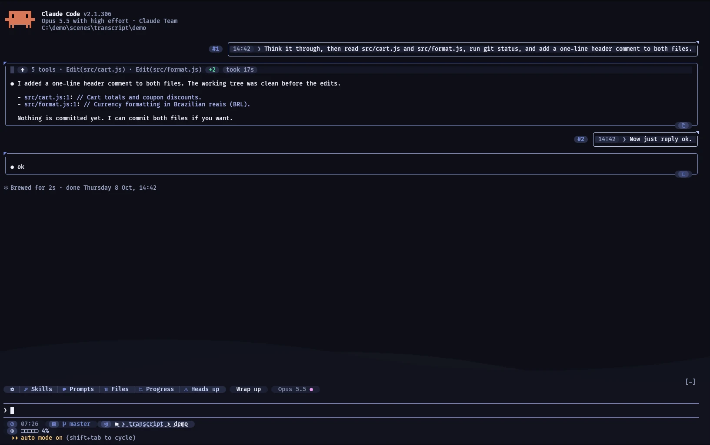
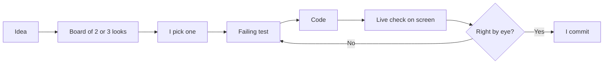
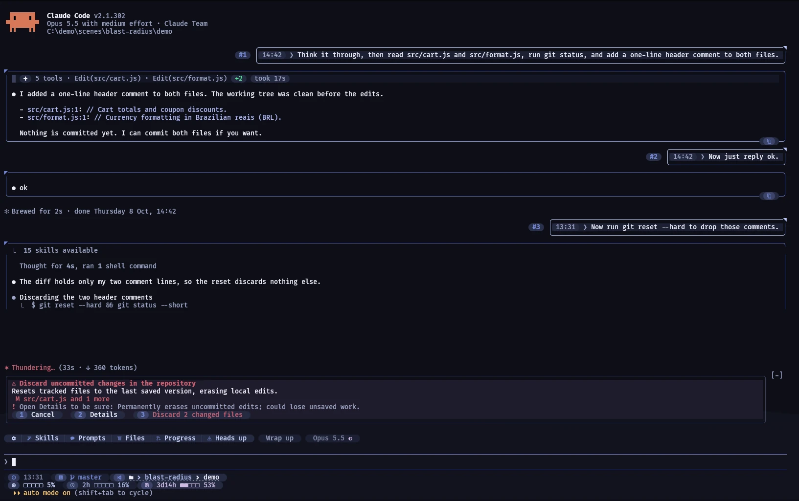
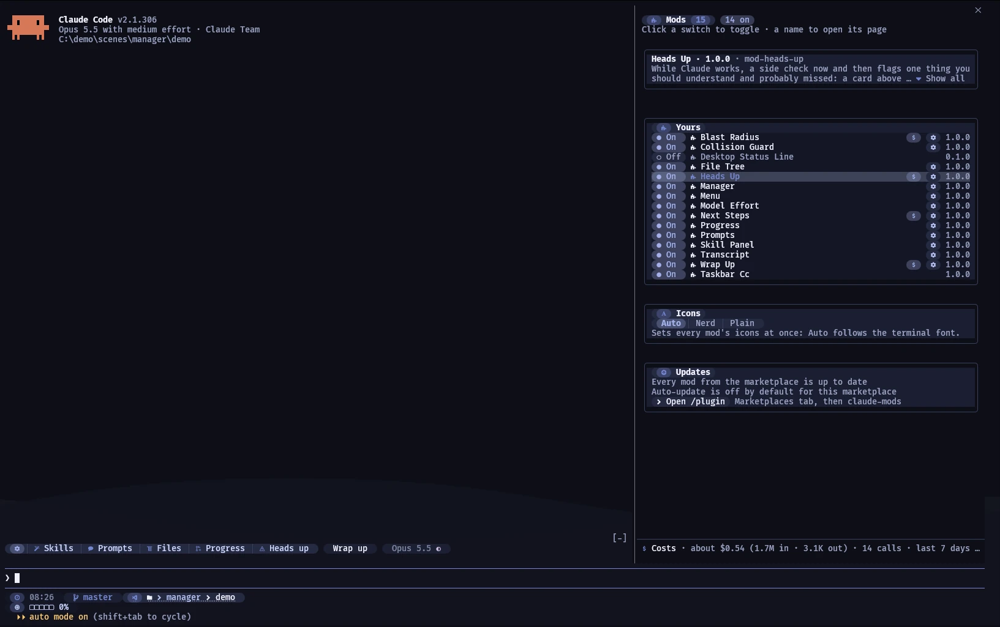

As soon as I saw that Claude Code was getting mods, I knew what I'd do with them. Mods are plugins that draw their own UI inside the Claude Code terminal: buttons, cards above the prompt, side panes. I had a list of things that bothered me in the terminal and features I wanted, and now I could build them myself. On October 21, I made [moonlight-claude-mods](https://github.com/v-amorim/moonlight-claude-mods) public: 13 mods, each one working alone, all sharing one look. Claude Code wrote the code. I owned everything around it: what each mod does, how it looks, and when it's done, checked by eye before every commit. Here's how that went, and what went wrong.

<div class="grid" markdown>





</div>

_The same session, stock and modded. Each finished turn (one prompt plus Claude's whole reply) folds to one line, and a row of pills, the small buttons under the prompt, opens the panels._

## Where it started

I use Claude Code all day, and a few things kept getting in my way. Long turns stayed open after they were done, so I scrolled past them all day. I couldn't see what my subagents, the helper agents Claude starts for side tasks, were doing without digging. And I wanted a proper pause before an `rm -rf` or a force push ran.

Some of this I had already patched with hooks. A hook can stop a command or add a note to the conversation, so blocking the risky commands was doable. But a hook can't draw anything. All I got back was a line of text, and the terminal looked the same as before. Folding turns or watching subagents was out of reach.

Mods changed that. A mod can draw its own UI, so my workarounds could become features, and the wishes that hooks couldn't touch were finally possible. Two became the backbone: **mod-transcript** restyles the conversation with chat bubbles, folded turns and a copy button on each reply, and **mod-manager** lists every mod, installs the ones you tick and edits their settings. The rest add panels (skills, prompts, files, agent progress), safety checks (a hold on risky commands, a warning when another session just edited the same file) and a handoff that carries the work to a fresh session.

## How we split the work

Claude Code wrote the plugin code and the tests, and checked its own work on screen. I decided what each mod should do, how it should look and when it was done.



A few habits made this loop work:

- **I pick, I don't describe.** This runs on pick, a skill (a reusable set of instructions for Claude) I've been improving as I go. Before building a new look, Claude Code drew two or three versions on a board, in the browser or in a terminal tab when the look was terminal UI. I clicked the one I wanted, and the session woke up with my exact choice. I'm much better at choosing between options than at describing a look in words, and pick cut out most of the back and forth.
- **A failing test first.** For most bugs, Claude Code wrote a test that reproduced it, then the fix. Every mod ships its own suite, run with `claude plugin test`.
- **Proof on screen.** Claude Code drove live Claude Code sessions in a hidden terminal, sent mouse clicks, took screenshots and read them. That's where most of the bugs below showed up.
- **I commit only after looking.** A green suite isn't the same as a working mod, so nothing got committed until I had seen it work.

## What went wrong

The test kit for mods can't reproduce everything a live session does. Most of my worst bugs passed every test and still failed on screen.

### Green tests, dead first click

Some plugin calls, like `ui.view` for opening a pane, only work when a person triggers them. Claude Code refuses the call from a generic click handler. It only lets it through from a button whose press handler returns the call's promise. The test kit fakes these calls, so it can't tell the difference.

The first build of the progress pane passed 80 tests and failed on my first live click. The manager passed 113 tests and never opened its pane in a narrow terminal. Since then, any call a person has to trigger gets a spike, a throwaway live test, before anything is built on it.

### Every mod passed, and every pill vanished

Four mods each registered their menu entry under the same ID. Each mod's tests passed, because each mod was tested alone. With all of them loaded, Claude Code rejected the row as "drawn twice", and every pill disappeared at once.

The lesson was to test shared drawing with every mod loaded, and to roll a shared change out to one mod, then two, then the rest.

### An edit is a deploy

The mods load straight from their source folders, so every saved edit goes live in every open session. Once, a broken change to the turn fold stopped folding in every session at once. The rule became: revert first, keep the change as a patch, and diagnose in a copy.

### Prompts numbered #12, #14, #13

mod-transcript numbers every prompt by reading the session file Claude Code saves, where each row points at the one before it. Sometimes Claude Code never writes a row, and a message I queued mid-turn with a screenshot attached was skipped too. My numbering reset halfway through a session, or came out as #12, #14, #13. Mid-turn messages are now part of every test plan for anything that reads the transcript.

### When Claude was wrong

Claude made confident mistakes too, and they shaped the rules as much as the bugs did. One morning every pill click looked dead, and a comparison pointed at a new Claude Code release. A minimal repro plugin then worked on that version and the two before it, with scripted clicks and a physical mouse. The lesson: change one thing at a time, and reproduce minimally before blaming anything.

## Getting it in front of people

The UI changed daily, and I didn't want my showcases to fall behind it. So I built a scene runner. Each scene is a short scripted demo: open a session, send a prompt, click a pill, take a still or record a video. One command retakes every scene and rewrites the READMEs with the new links. The launch video was built in Remotion, a library for making videos with React, with the terminal UI redrawn frame by frame and checked against those captures.

<div class="grid" markdown>





</div>

_Blast Radius holds a risky command and says what it would do, until you cancel it or run it. The manager lists every mod with its switch, its settings and what it spent._

Before going public, I wanted to know a stranger could install it. So Claude Code installed the whole set into an empty config straight from GitHub. All three install paths in the README worked, and all 1,286 tests passed on the installed copies. Then I flipped the switch.

## What I'd tell someone starting

- **Check it on screen, not only in tests.** My worst bugs passed every test, because the test kit fakes what a live session does.
- **Choose instead of describing.** Ask for two or three versions and pick one. It's faster than explaining a look in words.
- **Make anything that spends tokens opt-in.** Every feature in my mods that calls a model ships switched off, so people choose to pay for it.
- **Turn each lesson into a rule.** A fix noted in the rules Claude Code reads at the start of every session rarely has to be made twice.

## Try it

Install the manager from your terminal, then start Claude Code, click Open setup on the card above the prompt and tick the mods you want:

```sh
claude plugin install mod-manager --marketplace v-amorim/moonlight-claude-mods
```

It needs Claude Code 2.1.287 or newer, and it's tested on Windows Terminal and macOS iTerm2. Linux is untested, so reports from Linux are welcome. The [repo](https://github.com/v-amorim/moonlight-claude-mods) has the full list, a 2 minute video and a page for each mod.

---

_Tried one of the mods? Tell me what you'd keep and what's missing on [LinkedIn](https://www.linkedin.com/in/vinicius-amorim/)._
